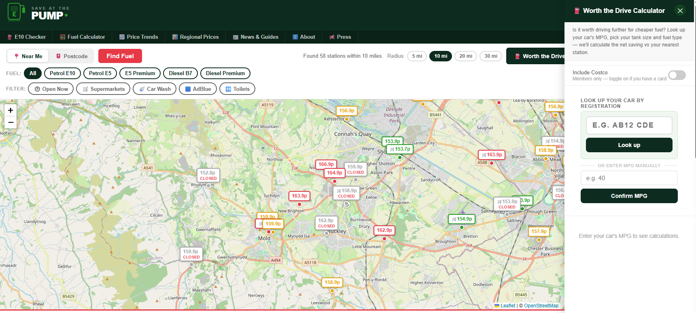
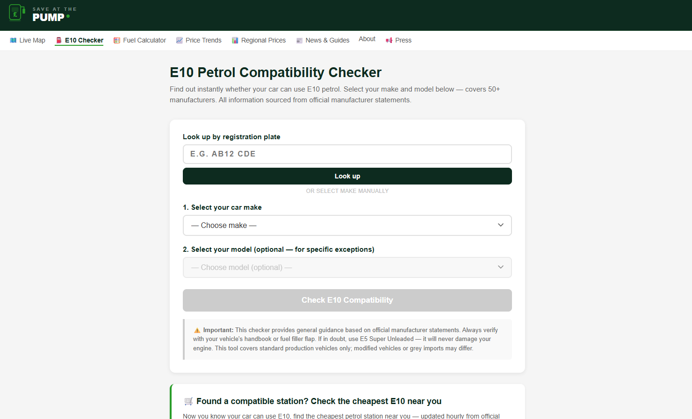
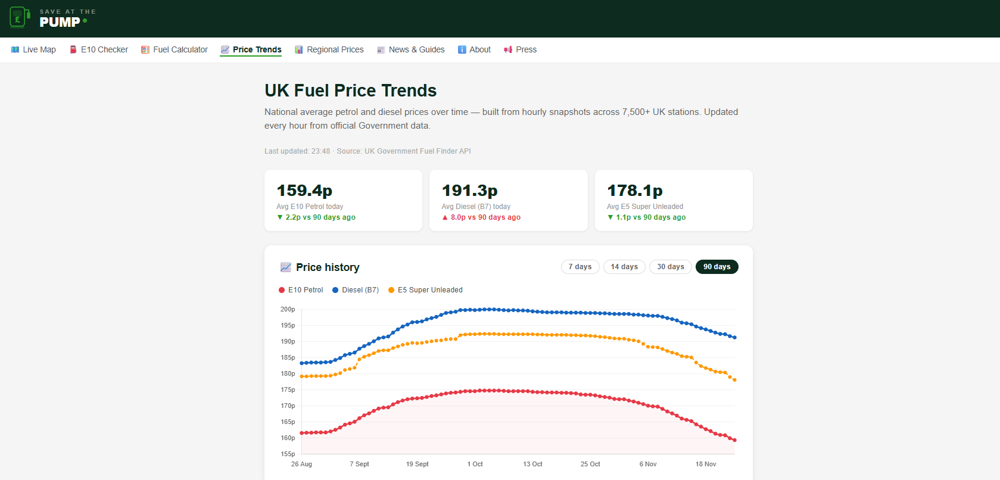
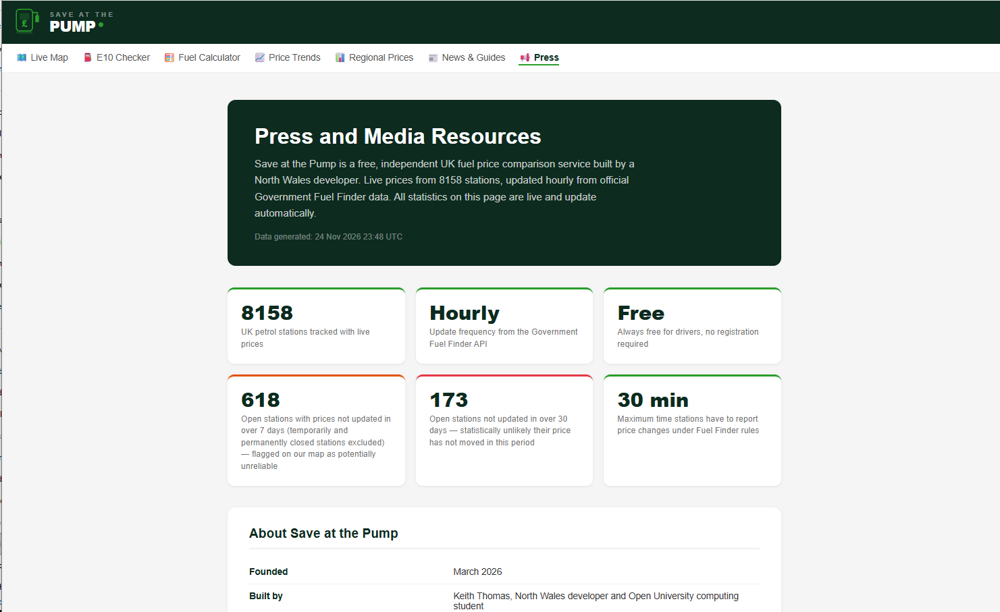
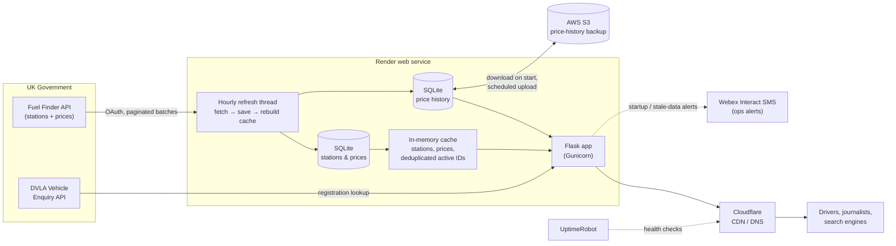

# Save at the Pump

**A free UK fuel price finder that turns the government's Fuel Finder data into a live map of the cheapest petrol and diesel near you.**

🔗 **Live site:** [saveatthepump.co.uk](https://saveatthepump.co.uk)

> **Source code is private.** Save at the Pump is a live commercial product, so this repository is a showcase only. It describes what the site does and how it's built. I'm happy to walk through the code in an interview.

---

## Screenshots

| Map: prices near you | E10 compatibility checker |
|---|---|
|  |  |

| Price trends | Press & data |
|---|---|
|  |  |

---

## Key features

- **Prices near you on a map.** Search by location and see every forecourt within a chosen radius, with E10 and diesel prices and how recently each station updated.
- **Data freshness indicators.** Stations that haven't changed a price in over 7 or 30 days are flagged, so drivers know which prices to treat with caution.
- **Price history and trends.** Per-station price history plus national trend charts, built from hourly snapshots.
- **E10 compatibility checker.** Look up a car by registration (via the DVLA Vehicle Enquiry Service) or by make and model to check whether it can use E10 petrol.
- **Fuel cost calculator.** Works out cost per mile and journey cost.
- **Regional price comparison.** Average prices by UK region.
- **Press and data page.** Live headline figures for journalists, including how many open stations haven't updated their prices recently.
- **Compliance export.** An admin report and CSV export of stations with stale prices, deduplicated and with closed stations excluded from the counts.
- **News and guides.** A blog of fuel-price explainers and guides, with an RSS feed and sitemap for search engines.
- **Installable web app.** A web app manifest lets mobile users add it to their home screen.

---

## Tech stack

| Layer | Technology |
|---|---|
| Language | Python |
| Web framework | Flask |
| App server | Gunicorn |
| Database | SQLite (current prices and station data, plus a separate price-history database) |
| Long-term storage | AWS S3 (price-history backups) |
| Hosting | Render |
| CDN, DNS and edge | Cloudflare |
| Data source | UK Government Fuel Finder API (OAuth client-credentials) |
| Vehicle data | DVLA Vehicle Enquiry Service API |
| Mapping | Leaflet with OpenStreetMap tiles |
| Charts | Chart.js |
| Alerting | SMS via Webex Interact; uptime checks via UptimeRobot |
| AWS SDK | boto3 |

---

## Architecture

---

## Notable engineering decisions

**Making the data trustworthy, not just available**
- **Deduplicating station registrations.** When a forecourt changes operator, Fuel Finder can keep the old registration alongside the new one, with frozen prices. Left alone, that made live stations look abandoned. Stations are deduplicated by postcode, keeping the most recently updated registration, and permanently closed stations are excluded.
- **One definition of "stale", used everywhere.** The admin report, the CSV export and the public press page originally counted stale stations in slightly different ways, so their figures could disagree. They now share a single function: closed stations are listed for transparency but excluded from compliance counts, and an explicit `counted_in_compliance` column shows exactly what was counted.
- **Verifying against the source.** Output is spot-checked row by row against the government's own Fuel Finder download before figures are shared externally.

**Running reliably on a small instance (512 MB RAM)**
- **An in-memory cache to fix out-of-memory crashes.** Map searches originally loaded and parsed every station and price record from SQLite on each request, which crashed the instance under load. The data is now loaded into memory once at startup and rebuilt after each hourly refresh, so searches read from RAM.
- **Durable history on ephemeral hosting.** The container's disk doesn't survive deploys, so price history is downloaded from S3 at startup and backed up to S3 on a schedule, with automatic cleanup of duplicate and old records.
- **Resilient API ingestion.** Paginated fetching with token renewal when the API's refresh endpoint isn't available, back-off and retry on rate limits (HTTP 429), and recovery from read timeouts without losing the refresh cycle.

**Operating it**
- **Monitoring and alerting.** UptimeRobot watches availability, and the app sends SMS alerts when it starts and when price data stops updating.
- **Debugging in production.** Diagnosed "missing" hourly refreshes as Python output buffering rather than a failure, by noticing that dozens of log lines shared identical timestamps, and fixed it with `PYTHONUNBUFFERED`. Traced a stale CSV export to Cloudflare edge caching rather than the app.
- **Security basics.** Parameterised SQL throughout, signed HttpOnly/Secure/SameSite admin cookies, constant-time password comparison, rate limiting on API routes, and security headers including a Content Security Policy.

---

## About

Built and run by **Keith Thomas** as a solo project, from data ingestion through to hosting, monitoring and content.

This project was developed with AI assistance. I used AI as a pair programmer for writing and reviewing code, debugging and research, while I directed the product, made the design decisions, and tested and verified the results.

[LinkedIn](https://www.linkedin.com/in/keiththomas77)
